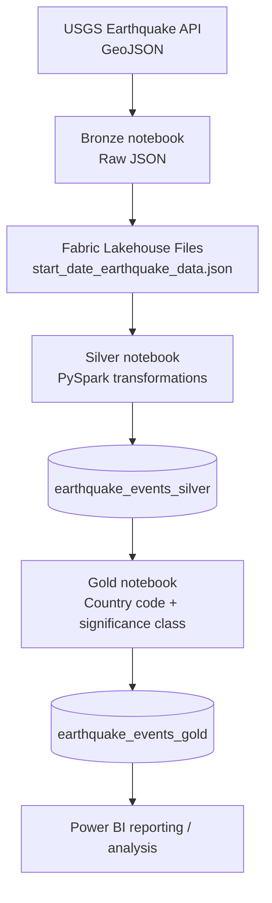

# Worldwide Earthquake Events | Microsoft Fabric Data Engineering Project

An end-to-end data engineering project that ingests worldwide earthquake event data from the **USGS Earthquake API** and processes it through a Medallion Architecture (Bronze, Silver, and Gold) using **Microsoft Fabric Lakehouse and PySpark notebooks**.

## Project overview

The project retrieves earthquake events for a supplied date range, stores the raw event payload in the Lakehouse Files area, transforms the nested GeoJSON fields into a structured Silver table, and enriches the records in the Gold layer with a country code and significance classification.

## Architecture



## Repository structure

```text
Worldwide-Earthquake-Events-Fabric/
├── notebooks/
│   ├── 01_Bronze_Layer_Processing.ipynb
│   ├── 02_Silver_Layer_Processing.ipynb
│   └── 03_Gold_Layer_Processing.ipynb
├── architecture/
├── documentation/
│   └── project_workflow.md
├── screenshots/
├── README.md
├── .gitignore
└── requirements.txt
```

## Technology stack

- Microsoft Fabric
- Fabric Lakehouse
- PySpark
- Python (`requests`, `json`)
- USGS Earthquake API
- Power BI (for downstream reporting, if configured)

## Data pipeline walkthrough

### 1. Bronze layer — raw ingestion

Notebook: `notebooks/01_Bronze_Layer_Processing.ipynb`

- Receives `start_date` and `end_date` as notebook parameters (the current notebook expects these variables to be supplied by the calling pipeline or notebook parameter configuration).
- Calls the USGS FDSN Event Web Service with `format=geojson`.
- Extracts the API response's `features` array.
- Writes the raw event records to the attached Lakehouse Files area as `<start_date>_earthquake_data.json`.

### 2. Silver layer — clean and structure

Notebook: `notebooks/02_Silver_Layer_Processing.ipynb`

- Reads the Bronze JSON file from `Files/`.
- Selects the earthquake ID, longitude, latitude, elevation, title, place description, significance, magnitude, magnitude type, event time, and updated time.
- Converts `time` and `updated` from epoch milliseconds to Spark timestamps.
- Appends the transformed records to the `earthquake_events_silver` table.

### 3. Gold layer — enrich and classify

Notebook: `notebooks/03_Gold_Layer_Processing.ipynb`

- Reads `earthquake_events_silver` and filters records using `time > start_date`.
- Uses the `reverse_geocoder` Python package and a PySpark UDF to derive `country_code` from latitude and longitude.
- Creates `sig_class` using the notebook's current thresholds:
  - `Low`: `sig < 100`
  - `Moderate`: `100 <= sig < 500`
  - `High`: `sig >= 500`
- Appends the enriched records to `earthquake_events_gold`.

## Running the project in Microsoft Fabric

1. Create or open a Microsoft Fabric workspace.
2. Create a Lakehouse and attach it to the notebooks.
3. Import the three notebooks from the `notebooks/` folder.
4. Ensure the notebook execution context supplies `start_date` and `end_date` where required. Use the same date format expected by the USGS API and your pipeline parameters.
5. Run the Bronze notebook first, then Silver, then Gold.
6. Ensure `reverse_geocoder` is installed/available in the Fabric notebook environment before running Gold.
7. Verify that the `earthquake_events_silver` and `earthquake_events_gold` tables were created and populated.
8. Build a Power BI semantic model/report from the Gold table if reporting is part of your workspace solution.

## Important implementation notes

- The notebooks use append mode for both Silver and Gold. Re-running the same date range can therefore create duplicate records unless the orchestration or data processing is made idempotent.
- The Gold notebook currently adds `country_code`; its comments/docstring mention city information, but a city column is not currently created in the supplied notebook.
- The Gold notebook filters with `time > start_date`. Confirm that the pipeline passes a value compatible with Spark timestamp comparison.
- The Bronze notebook writes to `/lakehouse/default/Files/`; make sure the default Lakehouse is attached.
- Do not commit credentials, access tokens, private connection strings, or sensitive data to GitHub.

## Workspace

The project was developed in a Microsoft Fabric workspace. Workspace connection reference:

`powerbi://api.powerbi.com/v1.0/myorg/Earthquake_project`

This is a Power BI/Fabric connection endpoint, not a public GitHub repository URL. Do not publish credentials or private workspace details.

## Future enhancements

- Add pipeline orchestration and parameter validation.
- Add retry logic and API error handling.
- Add deduplication/upsert logic using the earthquake event ID.
- Add data quality checks for null coordinates, invalid magnitudes, and duplicate IDs.
- Add audit logging and pipeline run metadata.
- Create a Power BI report with event counts, magnitude trends, geographic distribution, and significance categories.

## Author
Mayur Chinchole
